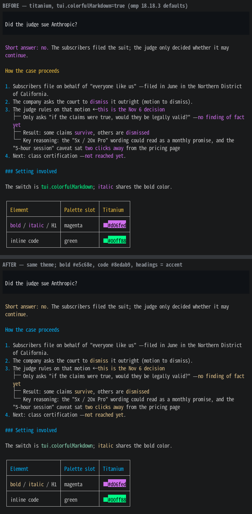

# titanium-accent — a calmer Colorful Markdown palette for omp

A drop-in variant of [omp](https://github.com/can1357/oh-my-pi)'s built-in **titanium** theme that keeps the theme's electric-blue identity but tones down the colors that omp 18.18's *Colorful Markdown* feature paints into every answer: bold text is no longer neon purple, inline code is no longer neon green, and the ✓ / diff-added / bash-command green is softened too.

## Install (3 steps)

1. Save [`themes/titanium-accent.json`](themes/titanium-accent.json) into your omp themes folder: `~/.omp/agent/themes/` (create the folder if it doesn't exist).
2. In omp, open **Settings → Appearance → Dark Theme** and pick `titanium-accent`.
3. Make sure **Settings → Appearance → Display → Colorful Markdown** is on (it is by default since 18.18).

That's it — nothing else in omp changes. The file is a full copy of titanium, so it works on its own and survives omp updates (it just won't pick up future tweaks to the built-in titanium).

## What changed

Colorful Markdown takes its colors from the theme's 16-color `terminal.ansi` palette with a fixed mapping (bold/italic/H1 → magenta slot, H2/table header → yellow slot, H3+ → blue slot, inline code → green slot). This theme only retunes those slots, plus one variable.

| Element | titanium | titanium-accent |
|---|---|---|
| **bold**, *italic*, H1 | `#d06fed` purple | `#e5c68e` soft gold |
| inline `code` | `#00ff88` neon green | `#8edab9` mint |
| H2, table headers | `#f0c040` yellow | `#00b4ff` electric blue (= accent) |
| H3–H6 | `#00b4ff` | `#00b4ff` (unchanged) |
| ✓ success, diff `+` lines, bash command names, git status (7 tokens via `readoutGreen`) | `#00ff88` | `#7ad689` |

List markers, links, borders, status line — everything else is untouched titanium.

## Why these values

Measured in OKLCH (a perceptual color space: lightness · chroma · hue):

- **Lightness matched to body text** (L ≈ 0.84). Emphasis should read as *colored prose*, not as brighter or darker prose — lightness jumps are what tire the eye.
- **Chroma ≤ half of the accent's.** Electric blue (C 0.16) stays the one "structure" color (headings, list numbers, links). Bold (C 0.08) and code (C 0.09) sit clearly below it, so the hierarchy reads: blue structure › gold emphasis › mint code › plain text. The original purple (C 0.20) and green (C 0.23) were *more* saturated than the accent, which inverted that hierarchy.
- **Hues 70°+ apart**: gold (82°), mint (165°), blue (237°). No purple/pink.

Tuned on a neutral dark background (`#191a1b`, Windows Terminal). Not meant for light terminals.

## Porting to another theme

Copy your theme's JSON from omp's `defaults.json` (or your own file), then change `terminal.ansi` slots **2** (inline code), **3** (H2/table header), **4** (H3+) and **5** (bold/italic/H1), applying the same rule: lightness ≈ your body text, chroma ≈ half of your accent. If the theme reuses one neon green for success/diff/syntax, find that variable in `vars` and soften it once.

## Credits / license

Derived from the `titanium` theme in [can1357/oh-my-pi](https://github.com/can1357/oh-my-pi) (MIT). This repository is MIT as well — see [LICENSE](LICENSE).

---

## 한국어 요약

omp 18.18부터 기본으로 켜진 "Colorful Markdown" 기능이 굵은 글씨를 네온 보라, 인라인 코드를 형광 초록으로 칠하는데, 티타늄 테마에서는 이게 눈이 아픕니다. 이 테마는 티타늄을 그대로 복제하고 **그 네 가지 색과 네온 초록 변수 하나만** 눈 편한 값으로 바꾼 것입니다 — 제목·번호·링크의 전기 파랑은 그대로 둡니다.

설치: `themes/titanium-accent.json` 파일을 `~/.omp/agent/themes/` 폴더에 넣고, omp 설정 → Appearance → Dark Theme에서 `titanium-accent`를 고르면 끝입니다 (Colorful Markdown은 켠 상태로).

원칙: OKLCH 기준으로 **밝기는 본문 글자에 맞추고, 채도는 전기 파랑의 절반 이하**로. 파랑 = 구조(제목·번호·링크), 금빛 = 강조(굵게), 민트 = 코드. 다른 테마에 옮기려면 팔레트 2·3·4·5번 칸과 네온 초록 변수만 같은 원칙으로 바꾸면 됩니다.
